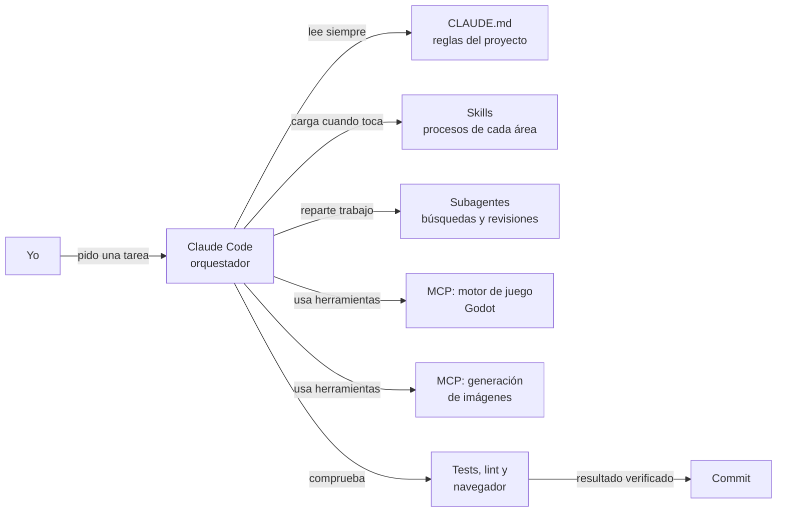

# Cómo trabajo con agentes de IA

> **EN:** How I build software with an AI agent (Claude Code) as the orchestrator:
> custom **skills**, **MCP servers**, project rules in `CLAUDE.md`, subagents and
> verification loops. The examples come from a private personal project
> (a turn-based video game: Godot 4 + Spring Boot + MySQL + React/TypeScript)
> and have been generalized so they can be shared. The project itself stays
> private; I'm happy to show it live in an interview.

Este repositorio enseña **cómo trabajo con un agente de IA** en un proyecto real:
qué le enseño, con qué herramientas lo conecto y qué reglas le pongo para que
el resultado sea fiable.

Los ejemplos salen de un proyecto personal —un videojuego por turnos con
**Godot 4**, backend en **Java / Spring Boot + MySQL** y un panel de datos en
**React + TypeScript**— y están generalizados para poder compartirlos. El
proyecto en sí es privado; lo enseño en directo en una entrevista.

---

## Las piezas

| Pieza | Qué es | Dónde |
|---|---|---|
| **`CLAUDE.md`** | Las reglas que el agente lee siempre: cómo se arranca todo, qué no se toca, cómo se manejan los secretos, cómo se comprueba un cambio | [`CLAUDE.md`](CLAUDE.md) |
| **Skills** | Un manual por área del proyecto. El agente la carga solo cuando la tarea cae en esa área, así que no gasta contexto el resto del tiempo | [`.claude/skills/`](.claude/skills/) |
| **MCP** | Servidores que dan al agente herramientas externas: abrir y lanzar el motor del juego, generar y animar sprites | [`.mcp.json.example`](.mcp.json.example) |
| **Subagentes** | Trabajo en paralelo sin llenar el contexto principal: búsquedas amplias, revisiones de código | — |
| **Verificación** | Nada se da por hecho sin comprobarlo: tests, lint y el navegador integrado para lo que se ve en pantalla | [`CLAUDE.md`](CLAUDE.md#comprobar) |

---

## Las skills de ejemplo

En el proyecto real hay seis (datos de combate, animaciones, interfaz en Godot,
panel de datos, integración de sprites y reparto de recompensas). Aquí hay tres,
generalizadas:

| Skill | Qué enseña al agente |
|---|---|
| [`cambios-en-base-de-datos`](.claude/skills/cambios-en-base-de-datos/SKILL.md) | El ciclo migración → aplicar → volcar → comprobar, y cómo tocar MySQL **sin que la contraseña acabe nunca en un fichero ni en la terminal** |
| [`integrar-asset-generado`](.claude/skills/integrar-asset-generado/SKILL.md) | Traer al proyecto un sprite generado con IA por MCP: identificarlo, confirmarlo con una persona, registrarlo y **no gastar créditos sin permiso** |
| [`verificar-en-el-navegador`](.claude/skills/verificar-en-el-navegador/SKILL.md) | Cómo comprueba el agente un cambio visual él solo, y cómo diagnostica un «no se guarda» midiendo antes de tocar código |

### Cómo escribo una skill

- **La `description` decide cuándo se carga.** Incluye las frases con las que
  alguien pediría esa tarea sin nombrarla («esto no se guarda», «ponle las
  etiquetas»), porque el agente decide por ella.
- **Explica el porqué, no solo el qué.** Una regla con su motivo se aplica bien
  en casos que la regla no previó.
- **Guarda lo que costó aprender.** Cada skill tiene su apartado de trampas: cosas
  que fallaron, cuánto costaron y cómo se evitan ahora.
- **Marca lo que cuesta dinero o no tiene vuelta atrás**, y exige preguntar antes.

---

## Las reglas que más me han servido

1. **Medir antes de tocar.** Ante un fallo, primero se mira qué contesta la API,
   qué pide la red y qué versión se está sirviendo. El fallo casi nunca está
   donde parece.
2. **Lo que cuesta dinero se pregunta siempre**, aunque parezca que ya está dicho.
3. **Los secretos no viven en el repositorio.** Salen del entorno, se pasan por
   ficheros temporales y se comprueban sin imprimirlos.
4. **Un avance verificado es un commit.** Pequeños, frecuentes y solo cuando la
   comprobación pasa.
5. **La persona tiene la última palabra en lo creativo.** El agente no inventa
   nombres ni encarga dibujos: propone y espera el visto bueno.

---

## Stack del proyecto de origen

Godot 4 (GDScript) · Java 21 + Spring Boot · MySQL 8 · React + TypeScript + Vite ·
Vitest · ESLint · Node.js · PowerShell · Claude Code · MCP

---

**José Manuel Zapata Martínez** · [github.com/joseicew](https://github.com/joseicew)

© José Manuel Zapata Martínez. Todos los derechos reservados: ver [`LICENSE`](LICENSE).
